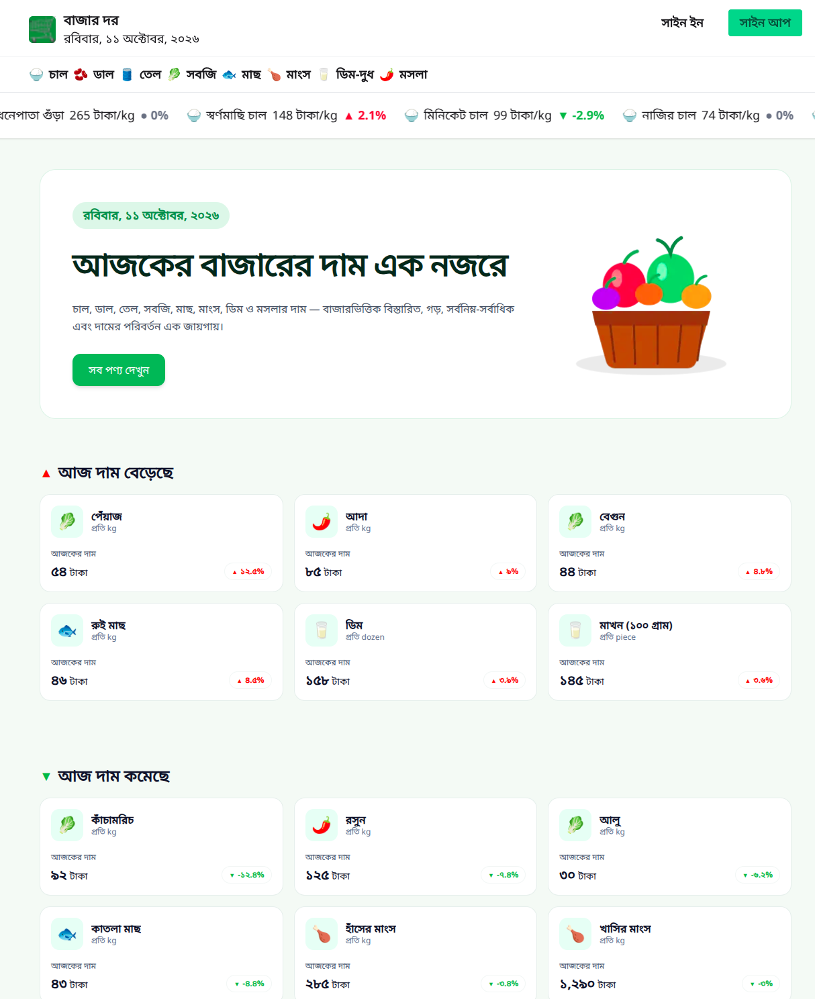

# 🛒 বাজার দর (Bazar Dor)

<div align="center">



### 🇧🇩 বাংলাদেশের নিত্যপ্রয়োজনীয় পণ্যের বাজারদর এক নজরে

**বাজার দর** একটি আধুনিক ও রেসপনসিভ ওয়েব অ্যাপ্লিকেশন, যার মাধ্যমে বাংলাদেশের নিত্যপ্রয়োজনীয় পণ্যের দাম দেখা, বিভিন্ন বাজারের দামের তুলনা করা এবং প্রতিদিনের দাম বাড়া-কমার তথ্য জানা যায়।

🌐 **লাইভ ওয়েবসাইট:** https://bazar-dor-web.vercel.app/

💻 **GitHub রিপোজিটরি:** https://github.com/shahidul91325/Bazar-Dor-Web

</div>

---

## ✨ প্রধান বৈশিষ্ট্যসমূহ

1. **📊 দৈনিক বাজারদর:** নিত্যপ্রয়োজনীয় পণ্যের বর্তমান দাম এবং দামের পরিবর্তন দেখার সুবিধা।
2. **📈 দাম বৃদ্ধি ও হ্রাস:** যেসব পণ্যের দাম বেড়েছে বা কমেছে, সেগুলো সহজে খুঁজে দেখা।
3. **🛍️ পণ্য ব্রাউজিং:** পণ্যের নাম, ছবি, বিভাগ, একক ও দামসহ পণ্যের তালিকা দেখা।
4. **🗂️ বিভাগ অনুযায়ী পণ্য:** বিভিন্ন বিভাগ থেকে পণ্য খোঁজা এবং কম থেকে বেশি বা বেশি থেকে কম দামে সাজানো।
5. **🔎 পণ্যের বিস্তারিত তথ্য:** পণ্যের সর্বনিম্ন, সর্বোচ্চ ও গড় দাম এবং বিভিন্ন বাজারের দামের তুলনা দেখা।
6. **🔐 ব্যবহারকারী নিবন্ধন ও লগইন:** ইমেইল ও পাসওয়ার্ডের মাধ্যমে অ্যাকাউন্ট তৈরি এবং লগইন করার সুবিধা।J

## 🛠️ ব্যবহৃত প্রযুক্তি

| প্রযুক্তি       | ব্যবহার                                       |
| --------------- | --------------------------------------------- |
| Next.js         | ওয়েব অ্যাপ্লিকেশন তৈরি ও রাউটিং               |
| React           | পুনর্ব্যবহারযোগ্য UI কম্পোনেন্ট তৈরি          |
| TypeScript      | টাইপ নিরাপত্তা ও কোড রক্ষণাবেক্ষণ             |
| Tailwind CSS    | ওয়েবসাইটের ডিজাইন ও স্টাইলিং                  |
| DaisyUI         | প্রস্তুত UI কম্পোনেন্ট                        |
| Better Auth     | ব্যবহারকারীর নিবন্ধন, লগইন ও সেশন ব্যবস্থাপনা |
| MongoDB         | ডেটাবেজ সংযোগ, কনফিগারেশন অনুযায়ী             |
| React Hot Toast | নোটিফিকেশন দেখানো                             |
| REST API        | পণ্য, বিভাগ ও বাজারদরের তথ্য সংগ্রহ           |
| Vercel          | ওয়েবসাইট ডিপ্লয়মেন্ট ও হোস্টিং                |

---

## 🚀 নিজের কম্পিউটারে প্রজেক্ট চালানোর নিয়ম

### প্রয়োজনীয় সফটওয়্যার

- Node.js (LTS সংস্করণ)
- npm
- Git
- প্রয়োজন অনুযায়ী MongoDB ডেটাবেজ

### ধাপ ১: রিপোজিটরি ক্লোন করো

```bash
git clone https://github.com/shahidul91325/Bazar-Dor-Web.git
```

### ধাপ ২: প্রজেক্ট ফোল্ডারে প্রবেশ করো

```bash
cd Bazar-Dor-Web
```

### ধাপ ৩: প্রয়োজনীয় প্যাকেজ ইনস্টল করো

```bash
npm install
```

### ধাপ ৪: Environment Variables সেট করো

প্রজেক্টের মূল ফোল্ডারে `.env.local` ফাইল তৈরি করো। তারপর তোমার কোডে ব্যবহৃত সঠিক Environment Variable-গুলো যোগ করো।

উদাহরণ:

```env
BETTER_AUTH_SECRET=your_secret_key
BETTER_AUTH_URL=http://localhost:3000
DATABASE_URL=your_mongodb_connection_string
```

**গুরুত্বপূর্ণ:** এগুলো উদাহরণমাত্র। তোমার প্রজেক্টের কোড অনুযায়ী ভেরিয়েবলের নাম ও মান যাচাই করবে। আসল পাসওয়ার্ড, API secret বা ডেটাবেজের credentials কখনো GitHub-এ প্রকাশ করবে না।

Google বা GitHub লগইন চালু থাকলে সংশ্লিষ্ট OAuth credentials এবং callback URL-ও কনফিগার করতে হবে।

### ধাপ ৫: ডেভেলপমেন্ট সার্ভার চালু করো

```bash
npm run dev
```

এরপর ব্রাউজারে খোলো:

http://localhost:3000

### ধাপ ৬: প্রোডাকশন বিল্ড তৈরি করো

```bash
npm run build
```

প্রোডাকশন বিল্ড চালাতে:

```bash
npm run start
```

---

## 📂 ওয়েবসাইটের গুরুত্বপূর্ণ রুট

| রুট                | কাজ                             |
| ------------------ | ------------------------------- |
| `/`                | হোমপেজ ও বাজারদরের তালিকা       |
| `/category/[slug]` | বিভাগ অনুযায়ী পণ্যের তালিকা     |
| `/product/[id]`    | পণ্যের বিস্তারিত তথ্য ও বাজারদর |
| `/sign-in`         | ব্যবহারকারীর লগইন               |
| `/sign-up`         | নতুন অ্যাকাউন্ট তৈরি            |
| `/profile`         | ব্যবহারকারীর প্রোফাইল           |

কিছু পেজ দেখার জন্য লগইন প্রয়োজন হতে পারে। এটি প্রজেক্টের authentication ও route-protection কনফিগারেশনের ওপর নির্ভর করে।

---

## 📱 রেসপনসিভ ডিজাইন

বাজার দর বিভিন্ন স্ক্রিনের জন্য উপযোগী করে তৈরি করা হয়েছে।

- **মোবাইল:** ছোট স্ক্রিনে ব্যবহার উপযোগী নেভিগেশন ও পণ্যের তালিকা।
- **ট্যাবলেট:** স্ক্রিনের আকার অনুযায়ী সাজানো লেআউট ও পণ্য কার্ড।
- **ডেস্কটপ:** বড় স্ক্রিনে প্রশস্ত লেআউট ও একাধিক কলামে পণ্য প্রদর্শন।

---

## 🔐 ব্যবহারকারী অ্যাকাউন্ট ও নিরাপত্তা

প্রজেক্টে Better Auth ব্যবহার করে ব্যবহারকারীর অ্যাকাউন্ট ও সেশন পরিচালনা করা হয়।

- ইমেইল ও পাসওয়ার্ড দিয়ে নিবন্ধন এবং লগইন।
- কনফিগার করা থাকলে Google ও GitHub লগইন।
- প্রয়োজন অনুযায়ী সুরক্ষিত পেজে প্রবেশ।
- প্রোফাইলের তথ্য ব্যবস্থাপনা।
- লগইন ও ফর্মের জন্য প্রয়োজনীয় বার্তা এবং যাচাই।

নিরাপত্তার জন্য গোপন তথ্য Environment Variables-এ রাখতে হবে।

---

## 🚢 ওয়েবসাইট ডিপ্লয়মেন্ট

প্রজেক্টটি Vercel-এ ডিপ্লয় করা হয়েছে।

**লাইভ ওয়েবসাইট:** https://bazar-dor-web.vercel.app/

নিজের প্রজেক্ট ডিপ্লয় করতে:

1. প্রজেক্টটি GitHub-এ পুশ করো।
2. Vercel-এ রিপোজিটরিটি Import করো।
3. প্রয়োজনীয় Environment Variables যোগ করো।
4. ডেটাবেজ ও লগইন কনফিগারেশন যাচাই করো।
5. প্রজেক্ট Deploy করো।
6. হোমপেজ, লগইন, বিভাগ, পণ্যের বিস্তারিত পেজ এবং সরাসরি URL খুলে পরীক্ষা করো।

---

## 📝 গুরুত্বপূর্ণ তথ্য

পণ্যের দাম সময়, স্থান ও বাজার পরিস্থিতি অনুযায়ী পরিবর্তিত হতে পারে। তাই প্রদর্শিত দামকে নির্দেশক তথ্য হিসেবে বিবেচনা করো।

**সঠিক বাজারদর জানার জন্য সংশ্লিষ্ট বাজারের সর্বশেষ তথ্য যাচাই করো।**

---

## 👨‍💻 প্রজেক্ট সম্পর্কে

**বাজার দর (Bazar Dor)** — বাংলাদেশের নিত্যপ্রয়োজনীয় পণ্যের দাম সহজে দেখা ও তুলনা করার জন্য তৈরি একটি ওয়েব অ্যাপ্লিকেশন।

- **GitHub:** https://github.com/shahidul91325/Bazar-Dor-Web
- **লাইভ ওয়েবসাইট:** https://bazar-dor-web.vercel.app/

---

⭐ **প্রজেক্টটি ভালো লাগলে GitHub রিপোজিটরিতে একটি Star দিতে পারো।**
